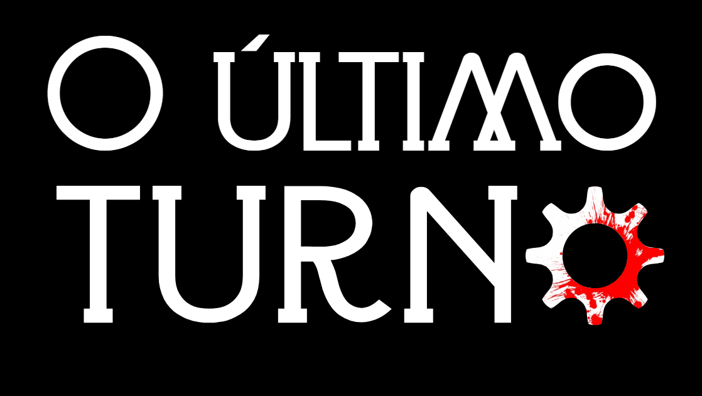

Jogo de investigação (*whodunit*) em linguagem C, feito para a atividade prática da disciplina de Algoritmos e Estrutura de Dados (AED 2026.2, CESAR School).

## Sobre o jogo

Um operário de *Tempos Modernos*, Chaplin, é encontrado morto ao fim do turno na fábrica. O jogador conduz a investigação como **Hercule Poirot** ou **Miss Marple** e tem **7 dias** para descobrir o culpado entre os suspeitos.

O assassino está entre os suspeitos e continua agindo à noite. Todo dia há um debate: o jogador interroga, os outros suspeitos reagem, e ele decide se prende alguém. Prender um inocente custa credibilidade. Chegar ao dia 7 sem prender o culpado é game over.

## Objetivo

Descobrir quem matou Chaplin, usando o caderno de pistas e depoimentos, antes que os 7 dias acabem ou que a credibilidade chegue a zero.

## Como funciona (resumo)

- **Duração:** 7 dias.
- **Suspeitos:** 6 no início (exemplo: Gerente, Capataz, Engenheiro, Operária, Enfermeiro e Vigia noturno), com 1 assassino e, possivelmente, 1 cúmplice.
- **Cada dia tem 4 fases:** Manhã (resumo e pista), Debate, Julgamento e Noite.
- **Debate:** os turnos seguem uma volta completa na lista de suspeitos vivos. O jogador pergunta, o suspeito responde e os demais reagem com "Concordo" ou "Discordo".
- **Credibilidade:** começa em 100. Prender o inocente custa pontos, e chegar a 0 é game over.
- **Caderno:** registra depoimentos, pistas e reações, e destaca contradições.

## Estruturas de dados e algoritmo de ordenação

| Item | Onde é usado |
|---|---|
| Lista circular duplamente encadeada | Ordem dos turnos dos suspeitos no debate |
| Lista simplesmente encadeada | Suspeitos, evidências e registros do caderno |
| Bubble sort | Ordenação das evidências |

## Tecnologias

- Linguagem **C**
- Interface: em breve

## Como compilar e executar

### Dependências

- Compilador C (GCC), Make e Git
- Bibliotecas de desenvolvimento do X11/OpenGL, usadas pela raylib

No Debian/Ubuntu/Linux Mint:

```sh
sudo apt install build-essential git libx11-dev libxrandr-dev libxinerama-dev libxcursor-dev libxi-dev libgl1-mesa-dev
```

### Passos

Clone o repositório já com os submódulos:

```sh
git clone --recurse-submodules https://github.com/RiosGabri/Ultimo-turno.git
```

Se o repositório já foi clonado, baixe os submódulos com:

```sh
make submodules
```

Compile e execute:

```sh
make
./build/jogo
```

O primeiro `make` compila a **raylib** a partir do submódulo (`raylib/`) e gera `raylib/src/libraylib.a`. O jogo é então compilado e linkado contra essa biblioteca local, sem depender de uma instalação do sistema.

Outros comandos:

```sh
make test        # testes da lista
make valgrind    # testes com verificação de memória
make clean       # remove a pasta build/
make distclean   # remove build/ e os artefatos compilados da raylib
```

## Como jogar

Em breve.

## Estrutura do projeto

Em breve.

## Equipe

<table>
  <tbody>
    <tr>
      <td align="center" valign="top" width="14.28%"><a href="https://github.com/Torzinus"><br /><sub><b>Heitor de Carvalho</b></sub></a><br /><a href="https://github.com/eduardommb/minicpu-simulator/commits?author=Torzinus" title="Code"></a></td>
      <td align="center" valign="top" width="14.28%"><a href="https://larissagiovanna.github.io/LarissaGiovanna/"><br /><sub><b>Larissa Giovanna</b></sub></a><br /><a href="https://github.com/eduardommb/minicpu-simulator/commits?author=LarissaGiovanna" title="Code"></a></td>
      <td align="center" valign="top" width="14.28%"><a href="https://github.com/RiosGabri"><br /><sub><b>Gabriel Parméra</b></sub></a><br /><a href="https://github.com/eduardommb/minicpu-simulator/commits?author=RiosGabri" title="Code"></a></td>
      <td align="center" valign="top" width="14.28%"><a href="https://github.com/eduardommb"><br /><sub><b>Eduardo Braga</b></sub></a><br /><a href="https://github.com/eduardommb/minicpu-simulator/commits?author=eduardommb" title="Code"></a></td>
        <td align="center" valign="top" width="14.28%"><a href="https://github.com/eliancunha"><br /><sub><b>Elian Cunha</b></sub></a><br /><a href="https://github.com/eduardommb/minicpu-simulator/commits?author=eliancunha" title="Code"></a></td>
    </tr>
  </tbody>
</table>


## Referências

- *Death Note: Kira Game*
- *Tempos Modernos* (Charles Chaplin)
- *Enola Holmes*
- Obras literárias de Agatha Christie
- Investigação póstuma